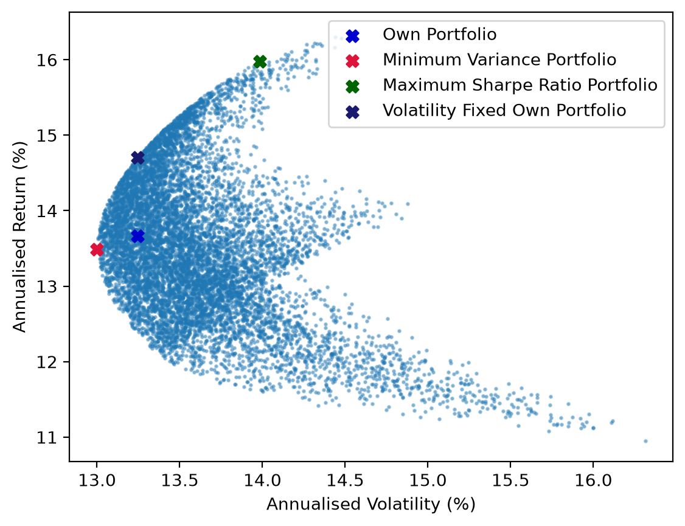
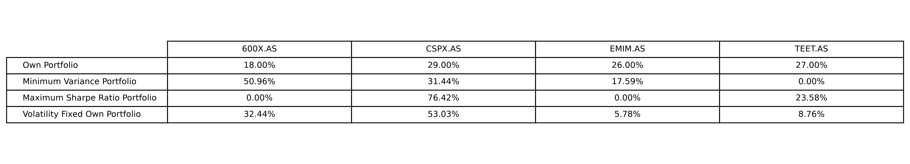
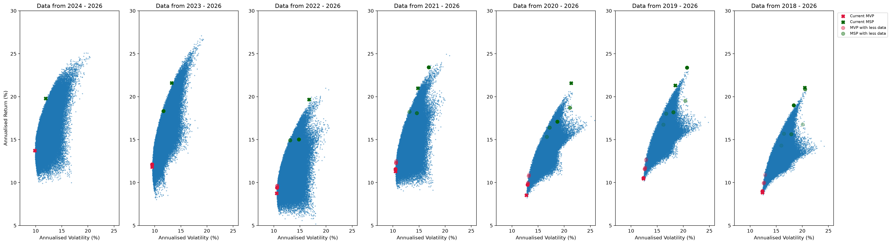
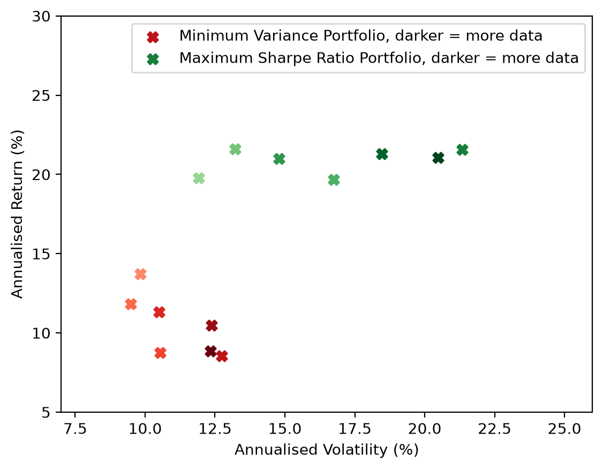
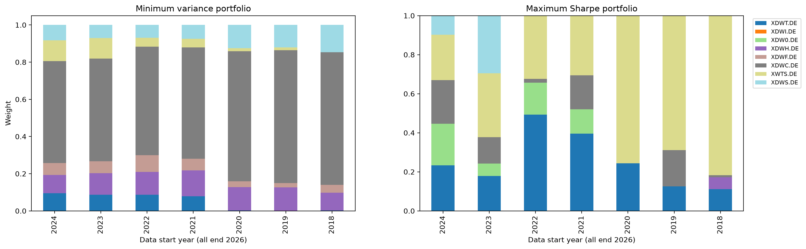

# Exploration of Quantitative Finance

Alongside my study of Econometrics and Data Science at the University of Amsterdam, I enjoy exploring quantitative finance in my spare time. By applying the mathematics, financial and statistics skills that are taught at the UvA (and beyond), I get to explore the real-world applications of what is taught. I plan to keep adding new projects to this repository, while also keeping up with the courses at the UvA. All code is written in Python 3.13. Questions and ideas are welcome, so feel free to get in touch via [LinkedIn](https://www.linkedin.com/in/thijs-van-de-leemkolk-1abbb2398/).
## Projects
 
### 00 - Efficient Frontier
 
This project optimises the allocation of my personal four-ETF portfolio using the *efficient frontier*. Using this method, I created efficient portfolios, which maximise expected return at a certain level of volatility. Using historical data, the annualised mean returns and covariance matrix can be found. By simulating thousands of random (long) portfolios, using the Dirichlet distribution, a graph can be plotted in which all possible portfolios are visualised, together with their historical return and volatility. By using mathematical methods, the following formulas (weights $w$, expected returns $\mu$ and covariance matrix $\Sigma$) can be found for the minimum variance and maximum Sharpe ratio portfolio:

$$ \mu_p = w^\top \mu \qquad \sigma_p^2 = w^\top \Sigma w \qquad S_p = \frac{\mu_p - r_f}{\sigma_p} $$
 
$$ \min_{w} \; w^\top \Sigma w \qquad \max_{w} \; \frac{w^\top (\mu - r_f \mathbf{1})}{\sqrt{w^\top \Sigma w}} \qquad \text{subject to } w_i \geq 0, \; w^\top \mathbf{1} = 1 $$
 
 Because of the long-only constraint $w_i \geq 0$, these problems have no closed-form solution and are solved numerically using `scipy.optimize`. Since my own portfolio was not efficient, I also found the highest-return portfolio for a given level of volatility.  When looking at the results, it would be beneficial to lower the percentage of EMIM and TEET and increase the percentage of CSPX in the portfolio. When re-evaluating my portfolio, these results should be evaluated accordingly. It is important to not be blindsided by focusing solely on the *efficient frontier*, other measures should also be taken into account.

 
 

## 01 - Impact of data start date on the Efficient Frontier

The previous project made me wonder what the impact of data-selection is on the *efficient frontier*. By optimising a portfolio consisting of 8 Xtrackers world sector ETFs, a wide cross-section of the market is covered. Historical data starting at different years, from 2018 to 2024, is collected in 7 different datasets. Using the same formulas as in project-00, the *efficient frontier*, minimum variance and maximum Sharpe ratio portfolio (MVP, MSP) are found for each dataset. The weights in these portfolios are saved. By applying these different weights, the performance of each portfolio can be shown on the *efficient frontier* of other datasets, which shows the effect of including more (older) data. From left to right, each graph adds another year of data

The minimum variance portfolio changes its location in the plot, but does seem to stay an efficient portfolio. The volatility is underestimated when less data is available, with seemingly random returns between 7 and 13%. The maximum Sharpe ratio portfolios change more over time, but more so in clusters. In the plot it is visible that the portfolios remain close together when the start dates of the data are close to each other, with it somewhat converging with at least 6 years of data. The returns stay close to each other, while the volatility increases when more years of data are added. For both portfolios, underestimating the volatility is the main concern when taking too little data.

 

Comparing the weights of the different portfolios, it is visible that the minimum variance portfolio largely stays the same, with some small changes between each. The weights of the maximum Sharpe portfolio fluctuate more between each dataset, with 2 clusters appearing: 2024-2021 and 2020-2018. Especially in the last cluster, the changes become minimal, it is not clear whether this is sheer coincidence or whether a pattern is emerging.

## Disclaimer
 
This repository is for educational purposes only and is not financial advice.
 
---
